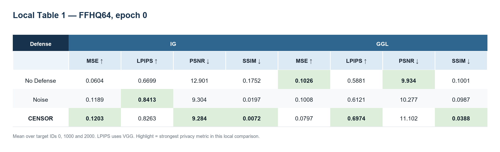
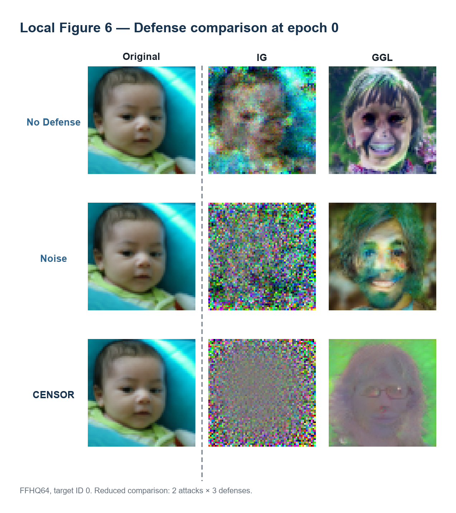
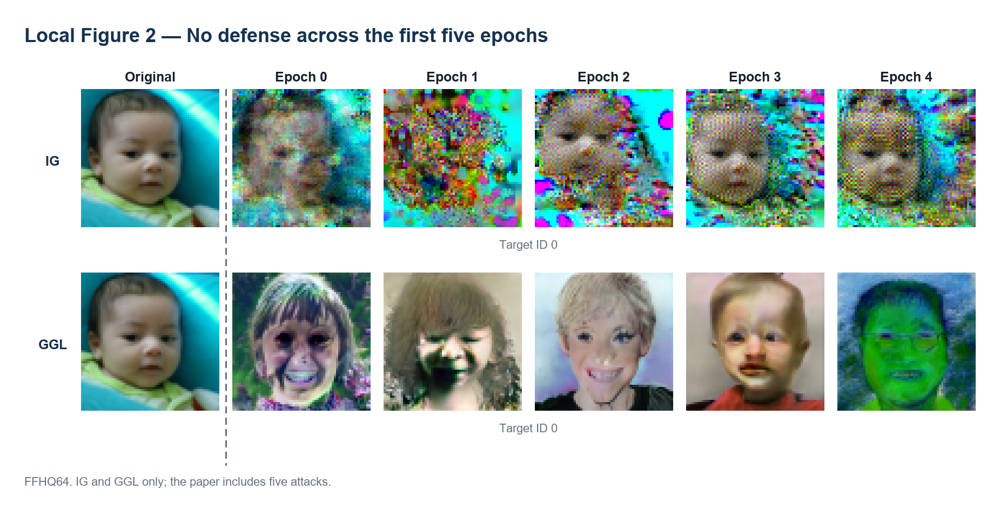

# CENSOR：基于正交子空间采样的梯度反演防御复现报告

> 论文：**CENSOR: Defense Against Gradient Inversion via Orthogonal Subspace Bayesian Sampling**（NDSS 2025）  
> 作者：Kaiyuan Zhang、Siyuan Cheng、Guangyu Shen、Bruno Ribeiro、Shengwei An、Pin-Yu Chen、Xiangyu Zhang、Ninghui Li  
> 论文：[NDSS 2025 PDF](https://www.ndss-symposium.org/wp-content/uploads/2025-915-paper.pdf)  
> 官方代码：[KaiyuanZh/CENSOR](https://github.com/KaiyuanZh/censor)  
> 复现者：刘明鑫

## 1. 复现工作概述

本项目对 CENSOR 的梯度反演防御流程进行了缩小复现，重点考察它对随机优化类攻击和生成模型类攻击的防御效果。

当前完成的内容包括：

- 配置并运行 FFHQ64 数据集；
- 运行 Geiping 梯度反演攻击和 GGL 攻击；
- 分别测试无防御、Gaussian Noise 和 CENSOR 三种设置；
- 对目标图像 0、1000、2000 进行重建；
- 记录 epoch 0–4 的重建结果；
- 计算 MSE、LPIPS、PSNR、SSIM 等指标；
- 生成缩小版论文表 1、图 2 和图 6；
- 针对 4 GB 显存修改评估设备、训练批量及显存释放流程。

当前复现范围为 **FFHQ64、2 种攻击、3 种防御、3 张目标图像和单次运行**，属于流程与趋势验证，不是论文全部数值的严格复现。

本次使用的主要设置如下。

| 项目 | 当前设置 |
| --- | --- |
| 操作系统 | Windows 11 + WSL/Linux |
| Python | 3.8 |
| PyTorch / CUDA | PyTorch 2.2.2 / CUDA 11.8 |
| 数据集 | FFHQ64 |
| 联邦模型 | ResNet-18 |
| 攻击 | Geiping（论文中的 IG）、GGL |
| 防御 | No Defense、Gaussian Noise、CENSOR |
| 目标图像 | ID 0、1000、2000 |
| batch size | 1 张待重建图像 |
| 实验 epoch | 0–4 |
| 每组目标图像数 | 3 |
| CENSOR 候选次数 | 20 |
| Geiping 最大重建迭代 | 2000 |
| GGL CMA-ES budget / sample | 100 / 10 |
| 噪声标准差 | 0.1 |

## 2. 方法简述

### 2.1 联邦学习中的梯度反演

在论文采用的联邦学习设置中，服务器向客户端发送当前全局模型。客户端使用本地数据计算梯度并上传，服务器再聚合多个客户端的梯度更新全局模型。

虽然客户端没有上传原始图片，但梯度中仍包含与输入、标签和模型预测有关的信息。诚实但好奇的服务器可以保存某个客户端上传的梯度，并利用梯度反演攻击恢复客户端的私有图片。

论文假设攻击者：

- 能够获得客户端上传的梯度；
- 知道模型结构和参数；
- 可以使用公开数据和预训练生成模型；
- 不能主动修改客户端收到的模型或上传的梯度。

### 2.2 本次复现的两种攻击

#### IG

IG 从随机图像开始，不断计算候选图像产生的梯度，并使它接近服务器观察到的梯度。优化结束后，如果候选图像与真实图像相似，则攻击成功。

本次配置使用：

- GAN-free 重建；
- 负余弦相似度相关的梯度匹配；
- 最大 2000 次优化；
- TV、图像范数等正则项。

#### GGL

GGL 不直接在像素空间中搜索，而是使用预训练 StyleGAN2 生成候选人脸，并利用 CMA-ES 在潜空间中搜索与目标梯度匹配的图像。

由于生成模型本身能够产生清晰人脸，GGL 即使没有恢复出同一个人，也可能得到一张看起来真实、类别大致一致的人脸。因此评价 GGL 时不能只看图像是否清晰，还要看它是否与原图身份和结构一致。

### 2.3 CENSOR

CENSOR 不直接上传真实梯度，而是在真实梯度的正交子空间中寻找替代梯度。具体过程为：

1. 客户端正常计算真实梯度；
2. 对模型每一层随机生成候选向量；
3. 去掉候选向量在真实梯度方向上的投影，使两者正交；
4. 将候选向量的范数调整到与原梯度相近；
5. 使用候选梯度临时更新模型，并在本地数据上计算损失；
6. 重复生成多个候选；
7. 选择使本地损失最低的候选梯度上传。

本次实验沿用论文默认设置，每次生成 20 个候选梯度。

CENSOR 的目标是同时满足：

- 上传方向不再与真实梯度相似，降低反演攻击效果；
- 替代方向仍能降低训练损失，保持模型可用性。

### 2.4 对照防御

本次选择 Gaussian Noise 作为对照。该方法直接向真实梯度加入标准差为 0.1 的高斯噪声。

Noise 与 CENSOR 的区别是：

- Noise 仍以真实梯度为中心进行随机扰动；
- CENSOR 主动在与真实梯度正交的空间中重新选择更新方向。

### 2.5 评价指标

本次使用四个主要指标，方向均表示“防御越强时指标希望如何变化”：

- **MSE ↑**：重建图与原图的像素均方误差，越高表示越不相似；
- **LPIPS ↑**：重建图与原图的感知距离，越高表示感知特征越不相似；
- **PSNR ↓**：重建质量指标，越低表示重建越差；
- **SSIM ↓**：结构相似度，越低表示结构越不相似。

多个指标可能给出不同排序，因此还需要结合重建图片进行判断。

## 3. 复现结果与分析

### 3.1 epoch 0 定量结果



下表为目标 ID 0、1000、2000 的平均值。

| 攻击 | 防御 | MSE ↑ | LPIPS ↑ | PSNR ↓ | SSIM ↓ |
| --- | --- | ---: | ---: | ---: | ---: |
| IG | No Defense | 0.0604 | 0.6699 | 12.901 | 0.1752 |
| IG | Noise | 0.1189 | **0.8413** | 9.304 | 0.0197 |
| IG | CENSOR | **0.1203** | 0.8263 | **9.284** | **0.0072** |
| GGL | No Defense | **0.1026** | 0.5881 | **9.934** | 0.1001 |
| GGL | Noise | 0.1008 | 0.6121 | 10.277 | 0.0987 |
| GGL | CENSOR | 0.0797 | **0.6974** | 11.102 | **0.0388** |

在 IG 上，Noise 和 CENSOR 均明显破坏了重建。CENSOR 在 MSE、PSNR 和 SSIM 上最好，Noise 的 LPIPS 略高。可以认为两种防御都有效，而 CENSOR 的结构破坏更明显。

在 GGL 上，指标出现冲突：CENSOR 的 LPIPS 和 SSIM 最好，但 MSE 和 PSNR 不如无防御。这说明 GGL 在生成模型先验下得到的图像可能具有“像人脸但不像原始人物”的特点，像素误差、结构误差和感知误差不一定同步变化。

因此，本次结果不能写成“CENSOR 在所有指标上都优于其他方法”。更准确的结论是：

> CENSOR 在 IG 上表现出稳定的防御效果；在 GGL 上明显降低了感知和结构相似性，但不同指标的排序不完全一致。

### 3.2 与论文 FFHQ 表 1 的对比

论文在 FFHQ 上使用 10 张图像，每种攻击运行 4 次并选择攻击效果最好的一次；本次只使用 3 张图像和当前保存的单次结果，因此只比较趋势。

#### IG（Geiping）

| 防御 | 来源 | MSE ↑ | LPIPS ↑ | PSNR ↓ | SSIM ↓ |
| --- | --- | ---: | ---: | ---: | ---: |
| No Defense | 论文 | 0.0143 | 0.5247 | 18.666 | 0.4209 |
| No Defense | 本次 | 0.0604 | 0.6699 | 12.901 | 0.1752 |
| Noise | 论文 | 0.0311 | 0.6666 | 15.298 | 0.2377 |
| Noise | 本次 | 0.1189 | 0.8413 | 9.304 | 0.0197 |
| CENSOR | 论文 | 0.1009 | 0.8347 | 10.125 | 0.0080 |
| CENSOR | 本次 | 0.1203 | 0.8263 | 9.284 | 0.0072 |

本次 IG 的 CENSOR 指标与论文 CENSOR 结果处于相近范围，但无防御和 Noise 的绝对数值已经与论文存在较大差异。因此这里只能说明“加入防御后重建质量明显下降”的总体趋势得到复现，不能说明数值严格重复。

#### GGL

| 防御 | 来源 | MSE ↑ | LPIPS ↑ | PSNR ↓ | SSIM ↓ |
| --- | --- | ---: | ---: | ---: | ---: |
| No Defense | 论文 | 0.0421 | 0.5424 | 14.167 | 0.1953 |
| No Defense | 本次 | 0.1026 | 0.5881 | 9.934 | 0.1001 |
| Noise | 论文 | 0.0454 | 0.5784 | 13.866 | 0.1752 |
| Noise | 本次 | 0.1008 | 0.6121 | 10.277 | 0.0987 |
| CENSOR | 论文 | 0.0823 | 0.8155 | 10.947 | 0.0219 |
| CENSOR | 本次 | 0.0797 | 0.6974 | 11.102 | 0.0388 |

本次 GGL 的 CENSOR 结果在 MSE、PSNR、SSIM 上与论文处于接近范围，但 LPIPS 低于论文。由于目标图像数量、随机搜索过程和运行次数不同，这一差异可以接受，但不能据此声称完成了论文表 1 的严格数值复现。

### 3.3 防御效果的视觉对比



以 target ID 0、epoch 0 为例：

- 无防御 IG 能恢复出与原图相似的婴儿面部轮廓；
- Noise 和 CENSOR 都使 IG 输出变成明显噪声，无法辨认原始人物；
- 无防御 GGL 生成了清晰人脸，但人物身份与原图不同；
- Noise 下的 GGL 仍能生成较清晰人脸；
- CENSOR 下的 GGL 输出严重模糊、偏色，人物身份和细节均难以辨认。

该结果复现了论文图 6 的核心趋势：CENSOR 能同时干扰随机优化攻击和生成模型攻击，但 GGL 即使攻击失败，也可能继续生成“看起来像人脸”的图像。

### 3.4 不同训练 epoch 的无防御攻击



在无防御条件下：

- IG 在多个 epoch 中仍能恢复婴儿面部的大致结构，但颜色和局部细节不稳定；
- GGL 在各 epoch 中持续生成清晰人脸，但生成身份不断变化，并不忠实对应原图；
- 攻击效果会随着模型训练状态改变，不能只依据单个 epoch 判断攻击能力。

这与论文的观察基本一致：梯度反演通常在训练早期风险更高，而 GGL 更擅长生成类别一致的高质量图像，不一定恢复出原始个体。

## 4. 快速启动指南

### 4.1 环境准备

官方环境文件为 `env.yml`：

```bash
conda env create -f env.yml
conda activate censor
```

本次实际运行环境使用 Python 3.8、PyTorch 2.2.2 和 CUDA 11.8。还需要确认：

- `FrEIA` 已安装；
- CUDA 编译器版本与 PyTorch CUDA 版本兼容；
- `CUDA_HOME`、`PATH` 和 `LD_LIBRARY_PATH` 已正确设置；
- GGL 所需的 StyleGAN2 权重已经放在配置指定位置。

### 4.2 数据准备

FFHQ 数据放在：

```text
data/ffhq
```

本次使用 FFHQ 128×128 thumbnails，程序读取后按 FFHQ64 配置缩放为 64×64。数据目录需要符合 `torchvision.datasets.ImageFolder` 的类别子目录结构。

### 4.3 运行六组实验

从项目根目录执行：

```bash
python run_rec.py --config configs_geiping_none.yml
python run_rec.py --config configs_geiping_noise.yml
python run_rec.py --config configs_geiping_censor.yml

python run_rec.py --config configs_ggl_none.yml
python run_rec.py --config configs_ggl_noise.yml
python run_rec.py --config configs_ggl_censor.yml
```

六组配置的对应关系为：

| 配置文件 | 攻击 | 防御 |
| --- | --- | --- |
| `configs_geiping_none.yml` | IG/Geiping | 无防御 |
| `configs_geiping_noise.yml` | IG/Geiping | 高斯噪声 |
| `configs_geiping_censor.yml` | IG/Geiping | CENSOR |
| `configs_ggl_none.yml` | GGL | 无防御 |
| `configs_ggl_noise.yml` | GGL | 高斯噪声 |
| `configs_ggl_censor.yml` | GGL | CENSOR |

每个配置使用 `num_exp: 3`，结果对应目标图像 0、1000、2000，并在 epoch 0–4 保存重建图片与指标。

### 4.4 生成汇总图表

六组实验全部完成后执行：

```bash
python generate_reproduction_figures.py
```

脚本会在 `results/summary/` 中生成：

- `table1_local.png`：缩小版表 1；
- `table1_local.csv`：表 1 数值；
- `figure2_local.png`：无防御下 epoch 0–4 的重建变化；
- `figure6_local.png`：三种防御的视觉对比；
- `metrics_by_sample.csv`：逐样本指标；
- `README.md`：结果说明及所选运行目录。

## 5. 遇到的困难及解决办法

### 5.1 缺少 FrEIA

**困难：**首次运行时出现 `ModuleNotFoundError: No module named 'FrEIA'`，程序无法加载可逆神经网络模块。

**解决办法：**在 `censor` 环境中安装 FrEIA 后重新运行。

### 5.2 FFHQ 数据缺失和下载中断

**困难：**程序最初找不到 `./data/ffhq`。使用官方脚本下载时，又多次出现 JSON 或图片文件大小不正确的问题。

**解决办法：**单独下载 FFHQ thumbnails 压缩包，确认完整大小后解压到 `data/ffhq`，再检查目录结构是否能被 ImageFolder 正常识别。

### 5.3 缺少 cuDNN 动态库

**困难：**运行卷积模型时出现 `libcudnn_cnn_infer.so.8` 或 `libcuda.so` 找不到的错误。

**解决办法：**补齐与当前 PyTorch/CUDA 对应的 cuDNN，并将 conda 环境下的 `lib`、`lib64` 加入 `LD_LIBRARY_PATH`。

### 5.4 StyleGAN2 扩展找不到 CUDA_HOME

**困难：**GGL 加载 StyleGAN2 自定义 CUDA 算子时，需要调用 `nvcc` 编译，最初出现 `CUDA_HOME environment variable is not set`。

**解决办法：**安装与 PyTorch CUDA 11.8 对应的 CUDA 编译器，并设置：

```bash
export CUDA_HOME="$CONDA_PREFIX"
export PATH="$CUDA_HOME/bin:$PATH"
export LD_LIBRARY_PATH="$CUDA_HOME/lib:$CUDA_HOME/lib64:$LD_LIBRARY_PATH"
```

同时确认 `nvcc --version` 显示 CUDA 11.8，而不是与 PyTorch 不一致的 12.x。

### 5.5 4 GB GPU 显存不足

**困难：**重建完成后计算 LPIPS、feature MSE 或进入随后的模型训练时出现 CUDA out of memory。原代码训练批量为 1024，不适合 RTX 3050 Laptop GPU。

**解决办法：**

1. 将 LPIPS 的 VGG 和 AlexNet 放到 CPU；
2. 将 feature MSE 所需的模型和输入临时放到 CPU；
3. 计算指标后把联邦模型移回 GPU；
4. 重建阶段结束后删除大张量并调用垃圾回收与 `torch.cuda.empty_cache()`；
5. 将 `inversefed/optimization_strategy.py` 中训练 batch size 从 1024 改为 64。

这些修改主要是显存适配，没有改变 CENSOR 的正交采样机制，但会使后续训练轨迹与论文服务器环境不完全相同。

## 6. 可复现性与限制说明

1. 当前只复现 FFHQ64，没有运行 ImageNet 和 CIFAR-10。
2. 当前只运行 IG/Geiping 和 GGL，没有复现 GI、GIAS 和 GIFD。
3. 当前只比较无防御、Noise 和 CENSOR，没有复现 Clipping、Sparsification 和 Soteria。
4. 论文对每种攻击运行 4 次并选择最佳攻击结果，再对 10 张图像取平均；本次只有 3 张图像和当前保存的单次结果。
5. 本次 PyTorch/CUDA 版本与官方 `env.yml` 不同，StyleGAN2 自定义算子和数值结果可能受到影响。
6. 为适应 4 GB 显存，LPIPS 和 feature MSE 被转移到 CPU，训练 batch size 从 1024 改为 64。
7. 训练 batch size 的修改会影响 epoch 1–4 的模型轨迹，因此这些 epoch 更适合观察本地趋势，不宜与论文逐值比较。
8. 当前图表适合说明代码链路已跑通和防御趋势存在，不能宣称完整复现了论文全部结论。

## 7. 方法解决的问题、局限与可尝试改进

### 7.1 方法解决的问题

CENSOR 解决的是：客户端怎样避免直接上传包含私有数据特征的真实梯度，同时仍向服务器提供能够训练模型的更新方向。

它在与真实梯度正交的高维空间中生成候选梯度，并使用本地损失选出有利于训练的候选。论文与本次缩小实验都说明，这种替代更新能够明显破坏梯度反演结果，同时保留继续训练模型的可能性。

因此，CENSOR 更准确的定位是：

> 在图像分类和诚实但好奇服务器场景下，显著缓解梯度反演泄露，而不是从理论上彻底消除所有隐私风险。

### 7.2 方法本身的局限

1. **缺少可量化的数学隐私保证。** 正交只说明上传方向与真实梯度垂直，不代表上传内容与私有数据完全独立。CENSOR 的隐私效果主要依靠攻击实验验证。
2. **依赖高维可选空间。** 高维模型中更容易找到兼顾正交和训练效果的候选方向；在轻量模型或 LoRA 低秩参数空间中是否仍然有效，需要重新验证。
3. **候选选择只显式考虑任务损失。** 原方法选择训练损失最低的候选，没有直接判断哪个正交候选泄露最少。
4. **每轮需要多次评估候选。** 论文报告的开销较低，但在低算力客户端和大型模型上的实际时间、内存及能耗仍需验证。

### 7.3 尚未充分解决的新问题

1. **多轮更新是否会累积泄露。** 攻击者可以保存同一客户端多轮上传的 CENSOR 更新，并在攻击阶段同时最小化多轮梯度匹配误差。论文没有系统研究这种跨通信轮次的联合反演。
2. **主动恶意服务器。** 论文假设服务器不能修改模型；如果服务器下发特殊模型诱导客户端产生易泄露更新，CENSOR 是否有效尚不明确。
3. **低秩和大模型场景。** Transformer、LoRA、Adapter 等结构的梯度空间与 ResNet-18 不同，原方法不能直接假设有效。
4. **其他隐私攻击。** CENSOR 主要评估图像重建，没有充分覆盖成员推断、属性推断和用户级信息泄露。
5. **更真实的 FedAvg 流程。** 论文主要采用客户端计算并上传批次梯度的设置，多次本地训练后上传累计模型差值的场景仍缺少充分研究。

### 7.4 值得尝试的改进

#### 面向多轮泄露的历史约束正交防御

先收集同一私有样本在不同通信轮次产生的 CENSOR 更新，验证攻击者联合使用多轮历史梯度时，是否比单轮攻击恢复得更好。

如果确实存在累积泄露，客户端可以维护最近若干轮已上传更新形成的低秩历史子空间。生成新候选时，使候选不仅与当前真实梯度正交，还尽量减少与历史公开子空间的重复信息。

该方向必须先验证多轮攻击现象。如果多轮联合攻击没有明显增强，历史约束方法就缺少成立基础。

#### 隐私风险感知的候选选择

先保存 CENSOR 每次生成的全部候选，并分别对这些候选运行攻击，判断它们的泄露程度是否存在稳定差异。

如果差异明显，可以设计轻量隐私风险分数，使客户端同时考虑：

- 候选是否能降低任务损失；
- 候选是否容易被梯度反演。

最终不再单纯选择损失最低的候选，而是在任务效果允许的范围内选择泄露风险更低的候选。

该方向的主要风险是：候选之间可能没有稳定的隐私差异，或者轻量风险指标与真实攻击结果不相关。

